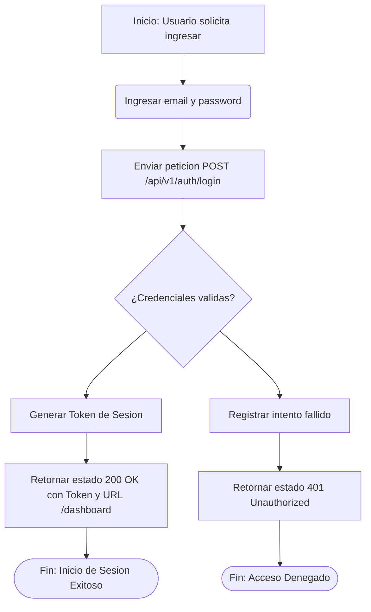
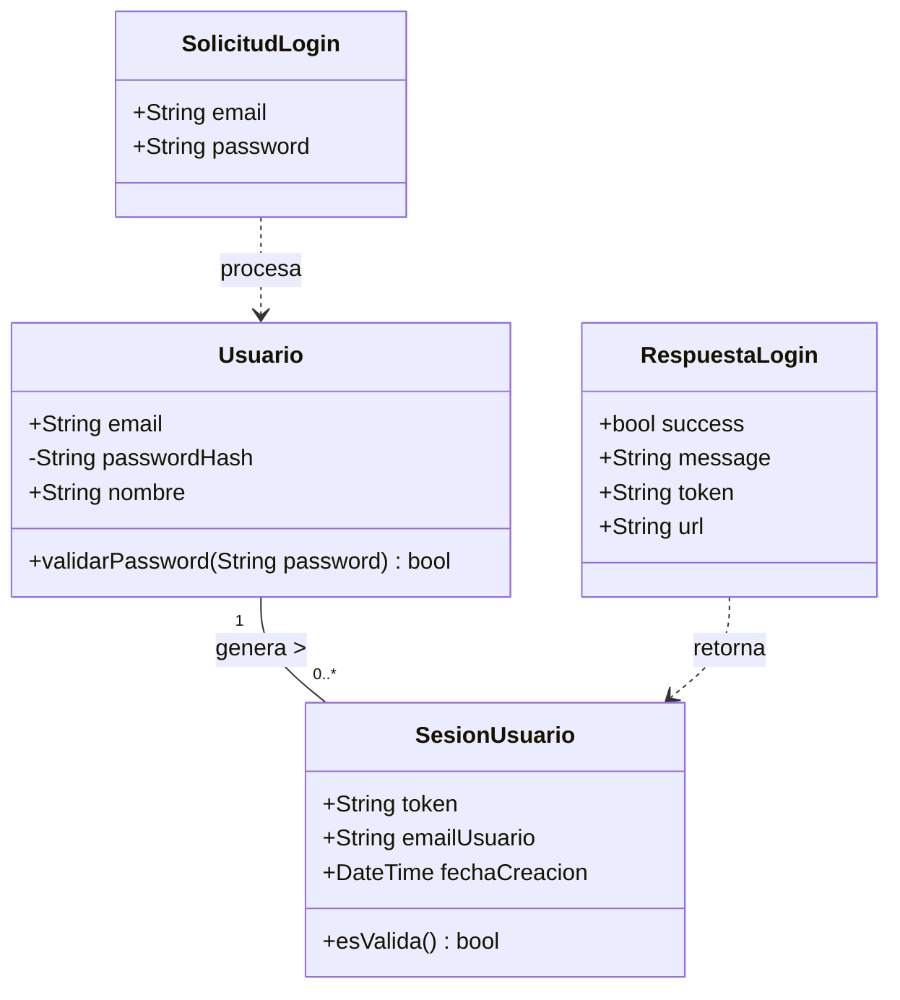

# Documentación de Diseño: Módulo de Autenticación (HU-101)

Este documento contiene los modelos conceptuales del proceso de autenticación.

---

## 1. Diagrama de Proceso (BPMN - Flowchart)

Mapea el flujo de control, la validación y los posibles estados de respuesta.

---

## 2. Diagrama de Clases (Modelo de Dominio)

Define las entidades, objetos de transferencia de datos y la relación entre componentes.

